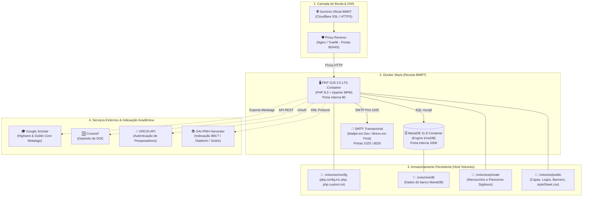
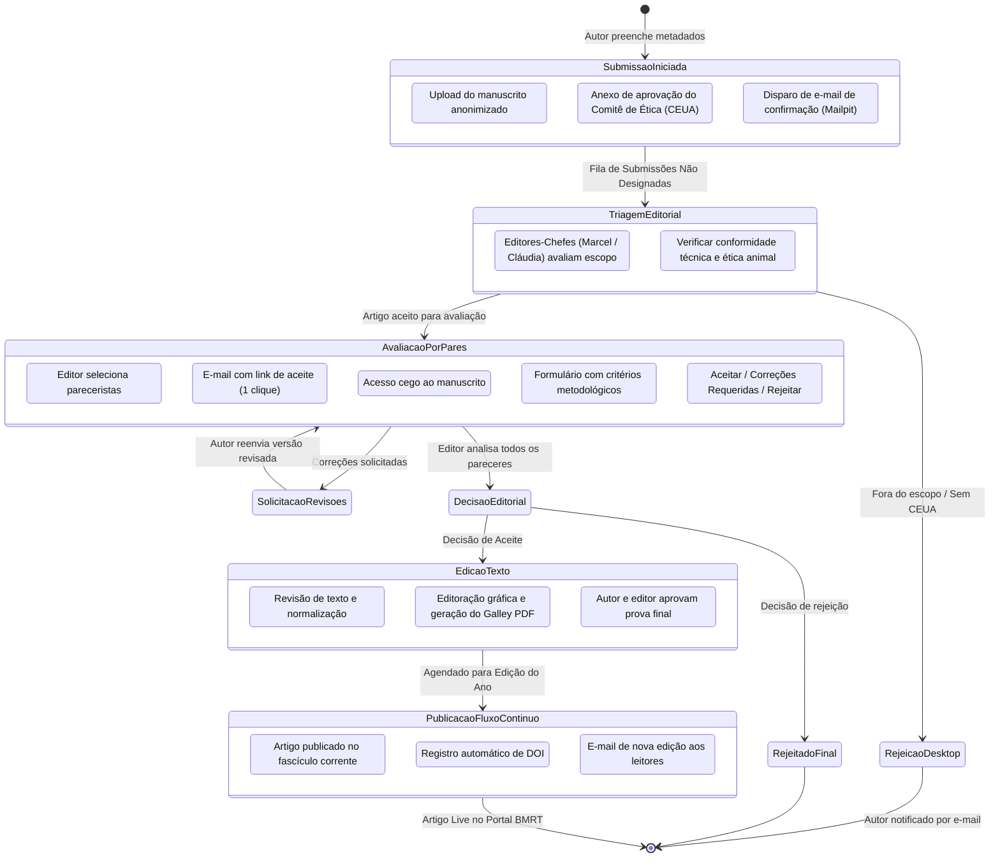
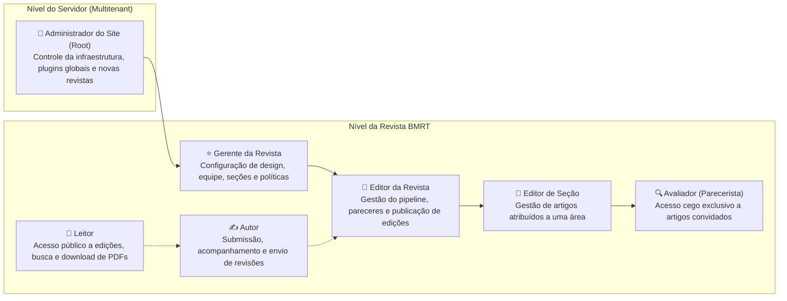

# Graphify — Arquitetura & Fluxos da Revista BMRT (OJS)

Este documento mapeia visualmente todos os componentes de infraestrutura, fluxos editoriais e entidades do sistema da revista **Biological Models Research and Technology (BMRT)**.

---

## 1. Grafo de Arquitetura de Infraestrutura (System Architecture)



---

## 2. Grafo do Pipeline Editorial (Fluxo de Artigos BMRT)



---

## 3. Grafo de Entidades & Banco de Dados (Data Entity Graph)

```mermaid
erDiagram
    CONTEXT ||--o{ SECTION : possui
    CONTEXT ||--o{ USER_GROUP : define
    CONTEXT ||--o{ ISSUE : organiza
    CONTEXT ||--o{ SUBMISSION : contem

    SUBMISSION ||--|| PUBLICATION : versao_atual
    SUBMISSION ||--o{ STAGE_ASSIGNMENT : possui_participantes
    SUBMISSION ||--o{ REVIEW_ASSIGNMENT : possui_avaliacoes
    SUBMISSION ||--o{ SUBMISSION_FILE : armazena_documentos

    PUBLICATION ||--o{ AUTHOR : tem_autores
    PUBLICATION }o--|| SECTION : pertence_a
    PUBLICATION }o--o| ISSUE : publicado_em

    USER ||--o{ USER_USER_GROUP : participa_de
    USER_GROUP ||--o{ USER_USER_GROUP : agrupa
    USER ||--o{ STAGE_ASSIGNMENT : atua_como
    USER ||--o{ REVIEW_ASSIGNMENT : avalia_artigo

    CONTEXT {
        int context_id PK
        string path "bmrt"
        string primary_locale "pt_BR"
        boolean enabled 1
    }

    SUBMISSION {
        int submission_id PK
        int context_id FK
        int current_publication_id FK
        int status "1=Ativo, 3=Publicado, 4=Rejeitado"
        datetime date_submitted
    }

    PUBLICATION {
        int publication_id PK
        int submission_id FK
        int section_id FK
        int issue_id FK
        string title
        string abstract
        string doi
    }

    USER {
        int user_id PK
        string username
        string email
        string password_hash
    }
```

---

## 4. Matriz de Papéis e Permissões (RBAC)


